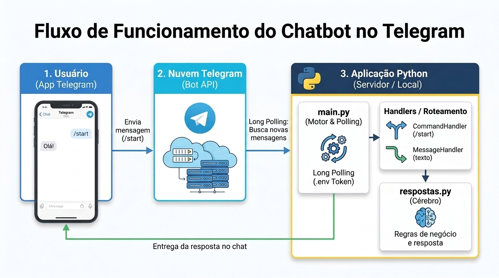

# 🤖 Chatbot Didático para o Telegram

Um robô de conversas simples, modular e fácil de entender, criado especialmente para quem está dando os primeiros passos no desenvolvimento de chatbots e Processamento de Linguagem Natural (PLN) com Python.

---

### 🗺️ Fluxo de Funcionamento

O diagrama abaixo ilustra o ciclo de vida de uma mensagem desde o envio pelo usuário até o processamento e resposta pelo código Python:



---


## 📁 Estrutura dos Arquivos

O projeto foi dividido em pequenos pedaços bem organizados para não assustar quem está começando:

| Arquivo | Para que serve? |
| :--- | :--- |
| [`.env`](file:///home/marcelo/projetos/pln/minimo-telegram/.env) | Guarda com segurança a sua chave secreta (token) do Telegram. |
| [`.env.exemplo`](file:///home/marcelo/projetos/pln/minimo-telegram/.env.exemplo) | Um modelo que mostra como deve ser o arquivo `.env`. |
| [`configuracao.py`](file:///home/marcelo/projetos/pln/minimo-telegram/configuracao.py) | Lê o token do arquivo `.env` e avisa se você esqueceu de configurá-lo. |
| [`respostas.py`](file:///home/marcelo/projetos/pln/minimo-telegram/respostas.py) | O cérebro do robô: decide o que responder quando uma pessoa fala com ele. |
| [`main.py`](file:///home/marcelo/projetos/pln/minimo-telegram/main.py) | O ponto de partida: liga o robô e o coloca para funcionar. |
| [`requirements.txt`](file:///home/marcelo/projetos/pln/minimo-telegram/requirements.txt) | Lista de bibliotecas necessárias para o projeto. |


## 🚀 Passo a Passo para Colocar o Robô no Ar

### 1. Criar o seu robô no Telegram (é de graça!)

1. Abra o seu aplicativo do Telegram no celular ou no computador.
2. Na barra de busca, procure pelo usuário oficial: **`@BotFather`** (ele tem um selo azul de verificado).
3. Inicie uma conversa com ele e envie a mensagem: `/newbot`.
4. Ele vai pedir um **nome** para o seu robô (ex: `Meu Primeiro Bot`).
5. Depois, vai pedir um **nome de usuário** (username) que termine com a palavra `bot` (ex: `meu_primeiro_teste_bot`).
6. O BotFather vai te dar uma chave longa chamada **API Token** (parece com algo como `123456789:ABCdefGhIJKlmNoPQRsTUVwxyZ`). Guarde esse código!


### 2. Guardar a sua chave no arquivo `.env`

1. Abra o arquivo [`.env`](file:///home/marcelo/projetos/pln/minimo-telegram/.env) no seu editor de código.
2. Troque o texto `COLE_SEU_TOKEN_AQUI` pelo token que o BotFather te enviou:

```env
TELEGRAM_TOKEN=123456789:ABCdefGhIJKlmNoPQRsTUVwxyZ
```

3. Salve o arquivo.


### 3. Instalar as dependências

Se ainda não estiver com o ambiente virtual ativado no terminal, execute:

```bash
# Ativa o ambiente virtual
source .venv/bin/activate

# Instala as bibliotecas necessárias
pip install -r requirements.txt
```


### 4. Ligar o robô

No terminal, execute o arquivo principal:

```bash
python main.py
```

Você verá a mensagem:
```text
🤖 Ligando o robô do Telegram...
✅ Robô pronto e conectado com sucesso!
👉 Abra o seu aplicativo do Telegram e converse com o seu robô.
```


### 5. Conversar com o robô

1. No Telegram, pesquise pelo nome de usuário (`@seubot`) que você criou.
2. Clique no botão **Começar** (ou envie `/start`).
3. Experimente conversar com ele enviando:
   - `/start`
   - `/ajuda`
   - `oi` ou `olá`
   - `tudo bem?`
   - `quem é você?`
   - Qualquer outra frase que desejar!


## 💡 Como personalizar o que o robô responde?

Abra o arquivo [`respostas.py`](file:///home/marcelo/projetos/pln/minimo-telegram/respostas.py) e localize a função [`criar_resposta_para_texto`](file:///home/marcelo/projetos/pln/minimo-telegram/respostas.py#L5-L27).

Lá você pode adicionar novas regras simples, por exemplo:

```python
if "qual o seu filme favorito" in texto_limpo:
    return "Eu adoro ficção científica, especialmente Interestelar! 🚀"
```

É só salvar o arquivo, reiniciar o robô com `python main.py` e testar no Telegram!
